<div align="center">
  
</div>

<br/>

<div align="center">

`Python 3.11+` · `NumPy core` · `offline by default` · `deterministic replay` · `provenance everywhere`

</div>

---

### 研究方向

个人智能体的长期记忆与个性化。Famulix 用每日简报检验记忆系统在实际日程中的表现，开发和测试围绕几个具体问题展开。

- 一条日程事件如何编码为记忆片段，又能从中提取哪些实体、事实、偏好、目标和提醒？
- 新记录与已有偏好冲突时，哪条应当生效？被取代的记录如何保留？
- 提示词的上下文预算有限，哪些检索结果值得放进去？
- 简报里的一条建议，能否沿引用查到它依据的原始记录？
- 删除一条记忆后，哪些数据投影和派生记录也需要处理？

日常开发用个人日程测试简报，回归评测则使用带标注的合成历史。

<div align="center">
  
</div>

### 当前项目 · [Famulix](https://github.com/easy1ive/famulix)

Famulix 是一个默认离线运行的个人智能体框架。随项目提供的每日简报应用使用模拟连接器读取数据，输出带记忆引用的 HTML 和 SVG。

| 模块 | 实现 |
| --- | --- |
| 记忆存储 | 事件以追加方式写入日志，SQLite 保存由日志生成的数据投影。个人记忆图谱用 `mentions`、`part_of`、`derived_from`、`supersedes` 和 `contradicts` 表示记录间的关系。 |
| 记忆更新 | 对记忆的显著性评分，处理记忆巩固与冲突消解。用艾宾浩斯式衰减描述遗忘，用 Brier 分数评估偏好预测的置信度校准情况。 |
| 检索与上下文 | 结合 BM25 和语义检索召回候选记录，用 MMR 减少重复。根据上下文预算选择记录，支持背包动态规划精确求解和贪心近似。 |
| 计划与执行 | 用领域专用语言（DSL）描述计划。执行器按策略检查操作，支持审批和主动触发。每日简报是这一层的应用。 |
| 隐私与验证 | 对个人身份信息（PII）脱敏，按隐私级别控制访问，以墓碑记录标记删除。会话支持字节级确定性回放。 |

核心依赖只有 NumPy，完整流程可在本地离线运行。PyTorch 是可选的 CPU 扩展。

评测使用 90 天的合成用户历史，预先植入并标注偏好、矛盾记录和干扰项。调整检索或记忆更新逻辑后，可以用同一批数据复测并核对指标。每次提交都会执行构建、测试和格式检查，pre-commit 钩子将检查结果写入 `.git/validation/`。

### 工程原则

1. 写入记忆时保留数据来源，使简报中的引用可以追溯到具体记录。
2. 为上下文预留明确的预算，同时核算运行时延和成本。
3. 核心流程支持离线运行，网络服务与额外模型按需启用。
4. 调试时用相同输入回放会话，逐字节核对输出。
5. 处理删除请求时，一并检查相关投影和派生数据。

### 开发工具

```text
语言      Python (3.11 / 3.12 / 3.13) · Shell
测试      pytest · 边界与性质测试 · 合成 persona 基准
质量      ruff · mypy · 逐提交钩子校验
数据      SQLite · NumPy · 可选 PyTorch (CPU)
形态      CLI + 可嵌入库 + 静态简报输出
```

<br/>

<div align="center">
  <picture>
    <source media="(prefers-color-scheme: dark)" srcset="https://raw.githubusercontent.com/easy1ive/easy1ive/output/snake.svg"/>
    <source media="(prefers-color-scheme: light)" srcset="https://raw.githubusercontent.com/easy1ive/easy1ive/output/snake-light.svg"/>
    
  </picture>
</div>

<br/>

<div align="center">

<strong>Chen Chunzhe</strong> · 陈淳哲

`easy1ive` · 广州

<sub>Memory is a design problem, not a storage problem.</sub>

</div>
