<div align="center">
  
</div>

<br/>

<div align="center">

`Python 3.11+` · `NumPy core` · `offline by default` · `deterministic replay` · `provenance everywhere`

</div>

---

### 我在做什么

我在广州大学读书，方向是把 **Personal Agent** 的前沿框架和真实应用捏在一起。比起再做一个会聊天的壳，我更关心智能体**记得什么、为什么记得、什么时候该忘**：

- 一条事件如何被编码成实体、片段、事实、偏好、目标与提醒；
- 新旧记忆冲突时，谁取代谁，被取代的那条如何留痕；
- 检索如何同时满足相关性与**上下文预算**，而不是把向量库倒进提示词；
- 个性化输出能不能被**引用回溯**到具体记忆，而不是凭空生成；
- 删除请求（right-to-forget）能不能真的穿透所有投影与派生记录。

白天写框架，晚上拿自己的日程当测试集。

<div align="center">
  
</div>

### 当前项目 · famulix

> 离线优先、记忆优先的个人智能体框架 + 每日简报应用。

| 层 | 内容 |
| --- | --- |
| 记忆层 | 只追加事件日志、SQLite 投影、个人记忆图谱（实体/片段/事实/偏好/目标/提醒 + mentions / part_of / derived_from / supersedes / contradicts） |
| 动态层 | 显著性打分、巩固与矛盾消解、艾宾浩斯式衰减与遗忘、偏好学习与置信度校准（Brier） |
| 检索层 | BM25 + 语义混合召回、MMR 去重、预算约束下的上下文装配（背包 DP 精确解 + 贪心近似） |
| 应用层 | 计划 DSL 与策略门控执行器、审批回路、主动触发、每日简报（mock 连接器 + 引用 + HTML/SVG 输出） |
| 保障层 | 隐私分级与 PII 脱敏、删除/墓碑语义、字节级确定性会话回放、合成 90 天 persona 与植入式评测 |

- 核心只依赖 NumPy；`torch` 是可选 CPU extra，不联网也能跑完整流程。
- 每个提交都过构建、测试与格式检查，pre-commit 钩子把验证回执落在 `.git/validation/`。
- 评测用合成 persona 历史：植入的偏好、矛盾与干扰项都有 ground truth，指标可复现。

<sub>仓库内的 2025–2026 提交时间线是演示时间线，详见各仓库 README 声明。</sub>

### 几条工作原则

1. **先让数据可追溯，再谈智能。** 没有 provenance 的“记忆”只是缓存。
2. **可预算的系统才是可部署的系统。** 上下文、时延、成本都要能算出来。
3. **默认离线。** 网络与模型是可选增强，不是前提。
4. **确定性优先。** 同样输入必须得到逐字节相同的输出，否则调试无意义。
5. **删除是一等公民。** 能记也要能忘。

### 工具与习惯

```text
语言      Python (3.11 / 3.12 / 3.13) · Shell
测试      pytest · 边界与性质测试 · 合成 persona 基准
质量      ruff · mypy · 逐提交钩子校验
数据      SQLite · NumPy · 可选 PyTorch (CPU)
形态      CLI + 可嵌入库 + 静态简报输出
```

<br/>

<div align="center">
  <picture>
    <source media="(prefers-color-scheme: dark)" srcset="https://raw.githubusercontent.com/easy1ive/easy1ive/output/snake.svg"/>
    <source media="(prefers-color-scheme: light)" srcset="https://raw.githubusercontent.com/easy1ive/easy1ive/output/snake-light.svg"/>
    
  </picture>
</div>

<br/>

<div align="center">

**Chen Chunzhe** · 陈淳哲 · Guangzhou University

`easy1ive` · 广州

<sub>Memory is a design problem, not a storage problem.</sub>

</div>
